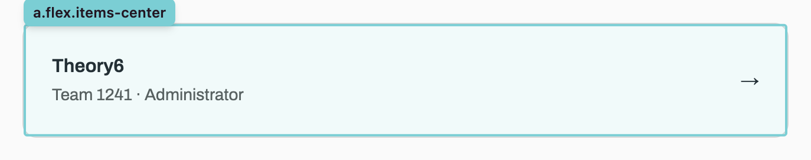
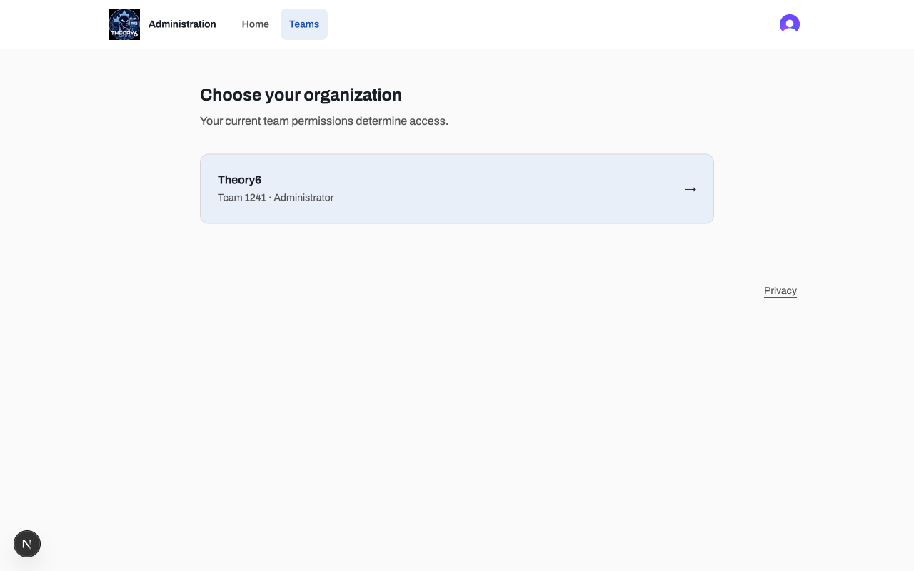
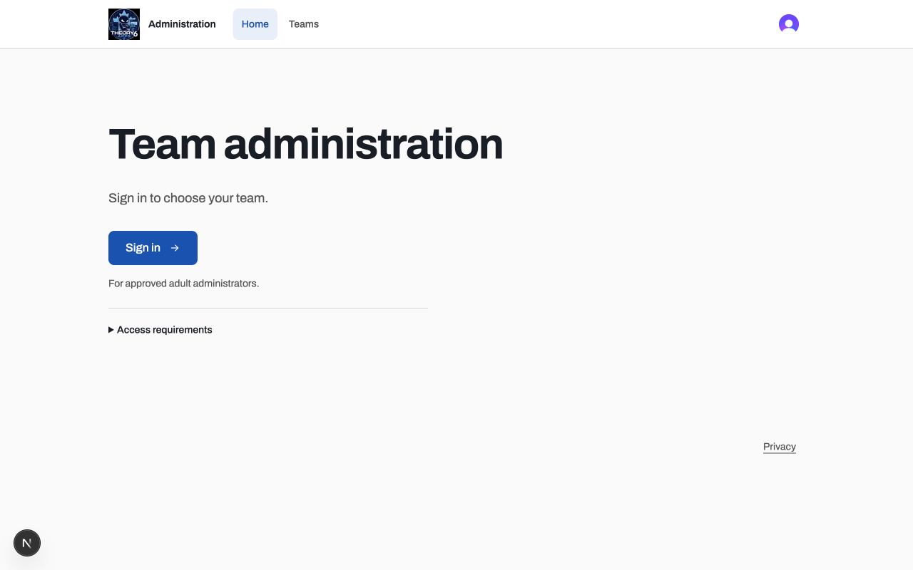
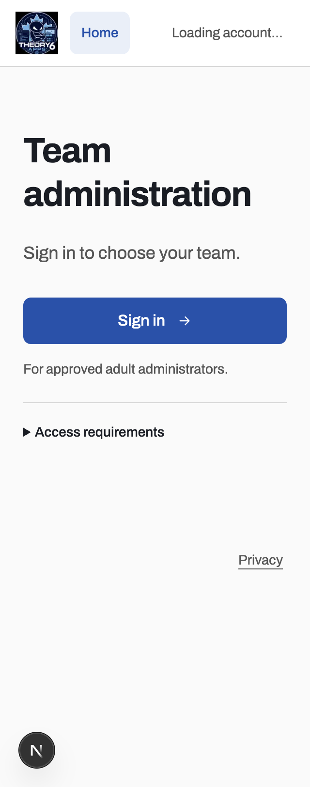

# Issue #28: administration design review

## Endpoint

This change installs project-level Impeccable tooling and implements the navigation, landing-page and typography refinements selected during review. The user confirmed this as the endpoint for #28. It preserves the light interface, Clerk login, explicit adult approval/linking and backend-authoritative team membership. It adds no backend features, product analytics or session replay.

## Review and decisions

The initial independent design and detector assessments covered the shell, home, sign-in, team selection, workspace, privacy and loading/error/empty/unavailable states. The initial Nielsen score was 24/40; this is a baseline, not a score for the final implementation. Public screens were initially rendered at 1280×800 and 375×812; protected states initially received source review because this worktree lacked local Clerk configuration. After configuring the existing development instance, sign-in, the signed-in shell, team selection and workspace were checked in the browser.

| Finding                                            | Result at the agreed endpoint                                                                                    |
| -------------------------------------------------- | ---------------------------------------------------------------------------------------------------------------- |
| Generic entrance, scattered instructions           | One short product heading, one purpose line and one primary action; eligibility details in a native disclosure.  |
| Header without useful navigation                   | Logo home button, labeled Home/Teams links with current-location state, Clerk profile button and sign-in action. |
| Inconsistent account escape                        | Profile/sign-out controls stay in the shared header; duplicate page-level sign-out removed.                      |
| Team context and unnecessary switching             | Verified team name/number remain visible; Change team appears only for multiple authorized teams.                |
| Typography lacked character                        | User selected Archivo; it is self-hosted by Next.js and shared with Clerk.                                       |
| Scouting-process explanations in administration UI | Removed from home and footer at user request. Existing privacy disclosures remain intact.                        |
| Square hover extending past rounded team list      | List clips backgrounds; keyboard focus outline is inset so it remains visible.                                   |
| Long organization names                            | Team rows wrap long text and preserve the navigation arrow.                                                      |
| Small phone controls                               | New header, team-switch, footer and home actions have at least 44px hit areas; home action is 48px.              |

The initial detector reported one Arial-style warning, treated as a style preference under the then-current system-font direction. Browser detection found two minor line-ending stragglers. Final focused home layout/design scans returned no findings. The detector is advisory; it does not prove usability.

## Validation

- `pnpm check`, repository-wide `pnpm typecheck`, `pnpm test:build-compat` and the web production build pass locally.
- The 23 non-database regression tests in the production-readiness workflow pass locally, including Clerk verification and web authorization routes. Database integration and restore tests run in CI's disposable Postgres service; they were not run against the shared development database for this UI change.
- Browser checks covered desktop and phone home layouts, native disclosure by pointer and keyboard, and the sign-in action reaching Clerk. Archivo was confirmed loaded in app and Clerk UI without browser requests to Google Fonts.
- Signed-in team-list hover now stays within 12px rounded corners. Keyboard row focus has a solid outline with a -4px offset. One-team workspace navigation hides Change team; a component-render check also verified the multi-team control remains available.
- At 320px, a temporary DOM-only organization label containing spaces and a long unbroken string produced no page or row overflow. The original label was restored; backend data was not changed.
- Measured home text contrast against its rendered backgrounds: body 16.19:1, secondary 7.14:1, action 7.32:1.
- No new motion was introduced; existing reduced-motion-aware loading behavior remains unchanged. Visual browser zoom, screen-reader announcements and a full live multi-team account flow were not separately exercised.

## Captures

The before capture is the user's annotated reproduction. The after captures show the implemented interface; they are representative evidence rather than pixel-identical viewport comparisons.

### Team hover before

### Team hover after

### Home after: desktop

### Home after: phone

## Remaining observations

The initial critique also identified privacy-notice scanability, more specific access-recovery guidance and the future-feature-only workspace message. These remain unchanged at the endpoint selected by the user; this PR does not claim to resolve every critique finding. No team provisioning, API-key management or scouting-data UI is added.
