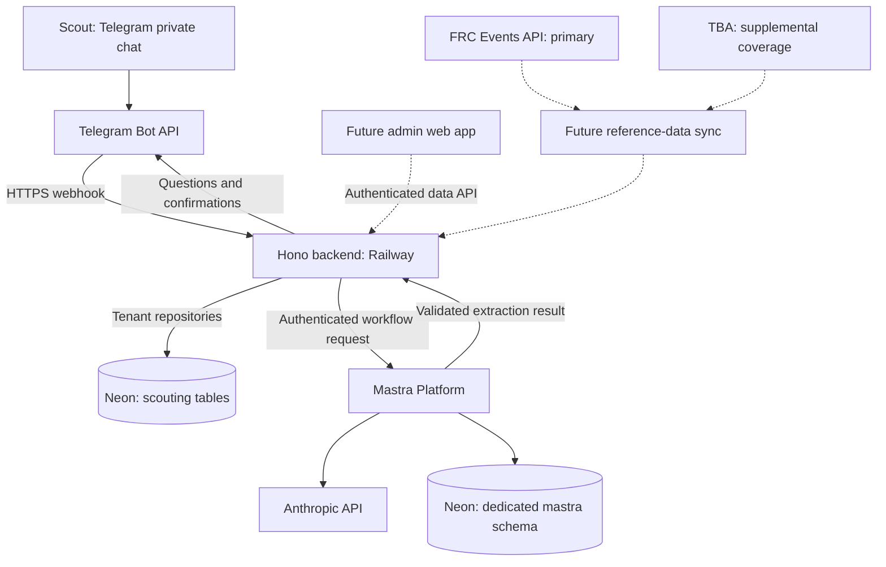

# AI Scouting system specification

Version: 1.0 • Updated: 2026-11-07 • Owner: Team 1241

This document consolidates the product decisions, implementation progress, architecture, deployment history, and future direction discussed during initial development. It is the current planning reference. “Implemented” describes repository code and previously verified deployments, not a fresh live-service audit. “Planned” records agreed direction; “proposed” identifies recommendations still open to change.

This is the authoritative product and architecture reference. Use [development](development.md) for local setup, migrations, tests, and build compatibility, and [operations](operations.md) for hosted configuration, releases, and invitation commands. GitHub issues/project track implementation status and dependencies; this document records intended behavior. Earlier design documents have been consolidated here; their history remains in Git.

## 1. Purpose and scope

Collect useful scouting information from students with minimal friction, preserve their original messages, extract consistent structured data, and eventually support team and match strategy. Initially serve Team 1241 at Canadian competitions, offseason events, and the World Championship. Keep a path to multiple organizations without building a public SaaS product prematurely.

Scouts use their phones to send typed or keyboard-dictated Telegram notes. Venue connectivity may be poor. Messages must identify their match explicitly; arrival time is not a reliable indication of the match observed. Telegram provides transport and queued sending, but the system is not an offline scouting database: server processing and replies require connectivity.

The original operating target is approximately USD $20/month. Free tiers are acceptable during development and interim production, including cold starts. That target is a budget goal rather than a guaranteed bill or event-day availability commitment.

## 2. Roles and user experience

| Role       | Intended responsibilities                                               |
| ---------- | ----------------------------------------------------------------------- |
| Scout      | Submit notes and answer follow-up questions                             |
| Strategist | Review observations, compare teams, and ask match-preparation questions |
| Admin      | Manage membership, invitations, events, specifications, and operations  |

The initial bot processes private chats. Group/channel intake is not implemented. Telegram enrollment creates a member with the scout role; strategist/admin promotion requires a separate administrative path.

### Implemented intake flow

1. Verify the Telegram webhook secret and validate the incoming payload.
2. Resolve the configured organization and enrolled Telegram identity.
3. Persist the original text and delivery identifier before AI processing. Duplicate deliveries do not create duplicate entries.
4. Acknowledge: “Received your scouting note. Processing it now…”
5. The backend worker claims the entry and calls the hosted Mastra extraction workflow with the session's pinned contract and its messages.
6. Validate each stated value, run the contract rules and determine completeness and follow-ups in application code.
7. For a complete result, save the draft extraction and reply: “Your scouting data has been saved. Thanks!”
8. For an incomplete result, ask for missing identity (match/team) in a separate message first, only when it is missing. Ask remaining contract questions afterward, in contract order with their authored wording.
9. Link the scout's ForceReply answer to the original entry and reprocess the original plus its replies.

“Saved” currently means the raw note and extraction JSON are persisted. A separate confirmed observation model is still planned. One note currently describes one team in one match; multiple observations in one message are outside the initial contract.

### Implemented enrollment

Admins can create, list, and revoke reusable Telegram invitations. Joining enrolls a scout, is idempotent, and preserves existing roles. See [operations](operations.md#invitations-and-membership) for commands and link handling.

## 3. Current implementation status

| Capability                                                           | Status                                                                   |
| -------------------------------------------------------------------- | ------------------------------------------------------------------------ |
| Hono backend and Mastra app in a pnpm monorepo                       | Implemented                                                              |
| Neon intake tables, tenant isolation, repositories, migrations/types | Implemented                                                              |
| Telegram webhook, enrollment checks, deduplication                   | Implemented and previously tested locally/hosted                         |
| Reusable admin invitation commands                                   | Implemented; production command routing previously verified              |
| Specification-driven Anthropic extraction and linked follow-ups      | Implemented with starter specification                                   |
| Separate development bot and Neon branch                             | Configured                                                               |
| Mastra Platform deployment and restricted backend credential         | Configured and previously smoke-tested                                   |
| Railway production backend                                           | Deployed                                                                 |
| GitHub production readiness and migration workflow                   | Implemented; user confirmed successful run                               |
| Automatic Render deployment after readiness                          | Configured, but one successful run did not trigger rollout; unresolved   |
| API-backed event configuration and session context                   | Implemented for issue #1                                                 |
| Reference imports and schedule validation                            | Implemented reference acquisition (#2) and participation validation (#3) |
| Final observations and review requests                               | Versioned finalized revisions and shared Telegram flag requests          |
| Admin web app and web authentication                                 | Proposed; not implemented                                                |
| Strategist agent, statistics, summaries                              | Planned; not implemented                                                 |
| Automatic/manual event mode                                          | Planned; not implemented                                                 |

## 4. Architecture and ownership

Solid connections represent existing integration; dashed connections represent planned work. Both Neon nodes are logical boundaries within the same database environment, not separate copied databases.

| Component           | Choice and responsibility                     | Reason / tradeoff                                                                                                                                                              |
| ------------------- | --------------------------------------------- | ------------------------------------------------------------------------------------------------------------------------------------------------------------------------------ |
| Scout channel       | Telegram                                      | Low setup effort; uses existing phones and supports typed/dictated input. Depends on Telegram accounts and venue connectivity.                                                 |
| Application backend | Node 24 + Hono on Railway                     | Owns intake, access control, scouting persistence, retries, and future reference sync/data API. Free hosting was accepted while Railway signup was unavailable.                |
| Agent runtime       | Managed Mastra Platform                       | Hosts extraction agents/workflows and Studio; avoids operating the agent server ourselves. Adds an HTTP/authentication boundary and platform usage charges.                    |
| Database            | Neon Postgres                                 | One transactional source for scouting data with separate dev/production branches and scale-to-zero capability.                                                                 |
| Agent storage       | Dedicated `mastra` schema in Neon             | Reuses database infrastructure while isolating agent tables and permissions. A shared compute budget and failure domain remain.                                                |
| Database access     | Kysely + pg, centralized backend repositories | Typed queries, explicit migrations, and one place for tenant/transaction rules. No route-level SQL or model-generated SQL.                                                     |
| Shared contracts    | `packages/scouting` + Zod                     | Specification, structured output, and deterministic completeness rules shared across applications.                                                                             |
| Formatting/lint     | Biome                                         | Shared workspace configuration and checks.                                                                                                                                     |
| Extraction provider | Direct Anthropic API key; Haiku 5.5           | Inexpensive extraction model. Quality must be measured on real scouting notes.                                                                                                 |
| Admin interface     | Small dedicated web app, proposed             | Suitable for event lists, specifications, review, and settings; Telegram retains scout intake and quick commands. Framework, hosting, and web identity provider are undecided. |

### Alternatives and rationale

Telegram was selected over building a native application initially to reduce delivery effort and avoid relying on a local phone number at Worlds. SMS adds carrier registration and delivery costs; alternative chat channels add onboarding/integration work. Native offline storage remains an option if venue testing reveals a concrete gap. Check school messaging policy before student rollout.

The original single self-hosted Mastra/Railway design was superseded by a backend plus managed agent runtime. Railway signup was unavailable during setup; Render was accepted as an interim host, including free-tier sleep. Fly.io was considered but not selected. Moving hosts is optional rather than a requirement to complete the product. Neon was retained over introducing Turso because a dedicated schema meets current agent storage needs without another database provider.

Correctness depends on explicit match context and linked replies, rather than ordered context commands or receive-time inference. Scout assignments (such as Red 2) could help resolve teams later, but are not currently a substitute for explicit, validated team identity.

### Repository layout

- `apps/backend`: webhook, commands, repositories, worker, migrations, generated database types, future APIs/sync.
- `apps/mastra`: agents, workflows, platform configuration, and agent storage adapter.
- `packages/scouting`: versioned requirements and shared runtime contracts.
- `docs`: system specification, operating guides, and historical decisions.
- `.agents/skills`: shared Neon and Mastra development skills; `.claude/skills` links to these copies. Skills are repository tooling, not separate application packages or duplicated per app.

Backend code stays centralized in its repositories until another consumer creates a concrete need for a shared backend package. Mastra returns results; the backend owns all scouting-table writes.

## 5. Persistence and security

### Existing data

`organization`, `member`, `channel_identity`, `raw_entry`, `invitation`, and `scouting_session` exist. The event implementation adds tenant-owned `event`, `organization_event_setting`, an `event_command` replay ledger, and an `intake_rejection` receipt table. Raw entries retain original text, receipt metadata, processing state, retry/lease information, parent linkage, and extraction JSON. Tenant-scoped delivery identifiers prevent duplicate intake.

Every tenant operation sets transaction-local `app.organization_id` on the same connection used by its queries. Forced row-level security and composite foreign keys protect organization boundaries. Runtime users must not have owner privileges or RLS bypass.

Production backend uses a restricted pooled connection. Migrations use a separate administrative unpooled connection. Mastra has a dedicated login restricted to its schema; development uses a separate login and development branch. Shared storage does not mean sharing an unrestricted database credential.

### Planned domain data

Add provider imports/caches, event teams, matches/participants, published specification versions, and final observations. Final observations should reference their source raw entries, event, match, team, author, and specification version. Corrections should retain history and identify the observation they replace.

Public reference facts can be shared; attendance, active-event selection, specifications, scouting observations, and manual organizational overrides must retain clear tenant ownership. The exact shared-reference schema is still a design decision.

Secrets remain in ignored local environment files or provider/GitHub secret stores. Never embed credentials in this document or source control. Hosted backend-to-Mastra calls use HTTPS and a dedicated service token restricted to the extraction workflow endpoint; Studio uses platform authentication.

### Durable scouting sessions

Each initial scouting submission creates a tenant/member-owned `scouting_session` in the intake transaction, using its root raw-entry ID as the stable Mastra run ID. It snapshots the active event and supported specification. New submissions require a valid active event; otherwise no note/session is created, and the scout must resend after event selection. Only rejected-delivery metadata is retained to prevent retries adopting a later event. Linked Telegram answers resume that run rather than starting another extraction workflow. The run suspends with the current requirements result. Backend requests defer workflow finalization so schedule clarification can resume the same run even after extraction has all required fields; the backend owns session completion. The backend stores match/team identity as it becomes available and tracks completion separately from immutable raw messages.

A session's turn ID is a hash of its original note and ordered replies. Replaying a persisted turn returns the cached result; concurrent identical requests in one Mastra process share execution. Provider errors suspend without a result so retry can resume the same run. A crashed execution left in a running/failed state needs operator recovery rather than silently starting another run. Snapshot storage must be configured. The backend rejects replies to completed sessions; scouts use /flag for investigation requests. Legacy workflow clients without deferred finalization still complete their run and reject new turns.

Sessions pin the publication (season, kind and version) assigned at intake. Processing refuses a version mismatch rather than silently changing an open session's requirements. Event context is pinned at intake. The session boundary is one initial submission and its explicitly linked replies. Provisional submissions remain independent. Once event/match/scout/team resolve, a newer note targeting an earlier open session requires an explicit “keep separate” reply; notes are never silently merged. Separate scouts and different scouted teams remain independent.

The session endpoint is `POST /scouting/sessions/:runId/turn`, authenticated with the backend service token. The stateless extraction workflow has been removed; the worker uses sessions exclusively. Run the database migration, deploy Mastra with the new endpoint, then deploy the backend. Do not switch the worker before the endpoint is available. Telegram outbound delivery still has the documented non-atomic send/commit limitation.

## 6. Extraction requirements

The current JSON requirements document is a starter template, not an official 2026 or 2027 game specification. It requires a match label, positive team number, and explicit climb outcome; free-text notes are optional. It is contract format 1 and supports text, positive integer and boolean fields.

Requirements determine field descriptions, required fields, and follow-up wording. Missing/ambiguous values become null; explicit false is valid data. Application code computes completeness instead of trusting an agent's assertion. Scout input is untrusted data and cannot override the specification.

Specifications are published immutable versions associated with season and observation kind (`match`, `pit`, `general`). Each note retains its assigned specification version across follow-ups and deployments. Re-extraction under another version must be explicit. The current session rejects changes to its pinned version. Define the actual 2027 requirements after Kickoff.

### Customizable contract (#45)

The [scouting contract](scouting-contract.md) defines format 2, the agreed shared contract that each team's builder authors. It is implemented in `packages/scouting` with tests and worked examples:

- Ordered questions with a stable code, readable label, scout-facing follow-up wording, model-facing extraction guidance, base required status and a typed answer: integer or decimal number with bounds, text, boolean, single choice or multiple choice with stable option codes.
- Structured show, hide, require and optional rules attached to questions, with typed comparisons, choice membership and all/any groups. No executable expressions.
- Three-valued evaluation. Unknown is never false, hidden questions are never required, and unresolved dependencies ask their nearest askable prerequisite, so an incomplete observation always has a follow-up.
- Validation with addressable errors for duplicates, invalid constraints, unsupported comparisons, missing references, self references, cycles, conflicting rules and identity violations.
- Protected identity by kind: match requires match and team; pit requires team and cannot ask for a match; general may ask for both. Event context comes from the session.
- Turn history: hidden answers stay as inactive history, are excluded from current values, completeness and export, and are not restored on reactivation without a new statement.
- `formatVersion` is separate from the publication identity. `readContract` reads existing format 1 publications with their original semantics.

Publication validation uses the shared contract validator for duplicate codes and protected identity. Telegram extraction, follow-ups and the data API use the contract (#48). Team admins edit, publish and assign specifications in the [specification builder](web-app.md#specification-builder-47) (#47). Preview is #49.

### Drafts, publication and assignment (#46)

Team admins create drafts, publish immutable versions and assign them to events through the web admin API. See [scouting specifications](web-app.md#scouting-specifications-46). Publication and assignment are separate actions. Match assignment stays on `event.specification_version` and accepts format 1 and format 2 publications. Pit and general assignments are stored per event and kind.

### Contract extraction in Telegram (#48)

- **Kind selection.** A plain note is match scouting, as before. `/pit <note>` and `/general <note>` start pit and general notes. `/scout <event-id> [pit|general] <note>` does the same for another event. The model never chooses the kind or the contract. A pit or general note at an event without an assignment for that kind is refused (`kind_unassigned`) and not stored.
- **Pinning.** Intake resolves the event's publication for the kind and stores its season, kind and version on the session. Replies and corrections keep the session's publication, even after the event's assignment changes. A new assignment affects new sessions only. Nothing is migrated or extracted again.
- **Extraction.** The backend sends the pinned contract and the ordered scout messages to Mastra. Each reply carries the follow-up it answered. The model input lists each question's code, label, follow-up wording, guidance and answer description, but not the rules. Structured output is derived from the contract: one entry per message, each with only the values that message states. Values are loosely typed so that an out-of-range number or an unlisted option comes back as stated and is checked by the application.
- **Evaluation.** After every extraction the backend folds the per-message statements (`foldTurns`), validates values and runs the rules. It decides completeness and asks for missing or invalid required answers and unresolved prerequisites. Hidden answers stay in history and inactive values. The Mastra run stays suspended after every turn; the backend is the only finalization authority.
- **Persistence.** Observations record kind, season, version, current values and per-question applicability (`state`, `requirement`), plus inactive values. Per-message statements and history go to internal provenance. General notes may have no team. Pit and general are not checked against the match schedule. A pit note whose team is not on the event roster gets a warning (`unknown_team`): the scout replies with the correct team number, or "save unverified" to keep it (outcome `warning_acknowledged`). This is a warning in both warn and strict mode. Off mode skips the check, and so does an event without a saved roster. General notes are not checked (`not_applicable`).
- **Data API.** Records include `kind` and `fields`. The specification route takes `?kind=`. See the [data API](api/README.md).
- **Deployment.** The turn request and response changed shape, so an old backend and a new Mastra (or the reverse) cannot talk to each other. Run the migration, set `EXTRACTION_ENABLED=false` on the backend, deploy Mastra, deploy the backend, then enable extraction again. Notes received meanwhile wait in the queue. In-flight Mastra runs resume with the new turn shape.

## 7. Event configuration and external data

API-backed event configuration, active-event selection, intake-time session binding and explicit delayed-note event selection are implemented for issue #1. FIRST event-detail lookup and selection by season/code are implemented. Roster/schedule imports, per-source caches, TBA supplementation, sync status and one-time scheduled acquisition with admin Telegram notifications are implemented for issue #2; paired regular-season, Ontario championship and Worlds fixtures and live checks cover verified 2026 playoff formats. Event-scoped match/team validation and Telegram context are implemented for #3. Command syntax and setup live in the [operations guide](operations.md#events).

### Source policy

Use the **FRC Events API as the primary source**, with **The Blue Alliance for supplemental coverage**, including offseason uploads. Event metadata is created and refreshed only through a provider API; manual JSON creation/editing is not supported. TBA imports official FIRST data, so it is not independent redundancy for a FIRST upstream outage. TBA's Trusted API also accepts directly supplied event data.

Sources: [FIRST API documentation](https://frc-api-docs.firstinspires.org/), [TBA source repository](https://github.com/the-blue-alliance/the-blue-alliance), [TBA developer APIs](https://www.thebluealliance.com/apidocs).

Use internal event/match IDs with optional source identifiers. Do not assume provider event codes match. Resolve corresponding event links automatically from provider-declared FIRST identifiers and a unique compatible match, with manual linking available when resolution fails. Track provenance, last successful synchronization, errors, and organization settings. Provider refreshes update provider facts while preserving organization settings and stable session links; missing primary fields can be supplemented. Provider adapters should normalize data before repository persistence.

### First event settings

| Setting                   | Requirement                                                       |
| ------------------------- | ----------------------------------------------------------------- |
| Name and season           | Any supported year, including historical/offseason testing        |
| Source identifiers        | FRC Events identifiers; TBA identifiers when its adapter is added |
| Event type                | Official, offseason, practice                                     |
| Dates/timezone            | Local event context and schedule rendering                        |
| Attendance                | Whether 1241 attends; scouting another event remains possible     |
| Specification version     | Explicit published requirements for extraction                    |
| Validation mode           | Off, warn, strict; initially warn                                 |
| Archive state             | Preserve history and remove old events from ordinary selection    |
| Organization active event | One active scouting event for 1241 initially                      |

Active event is an organization setting. Attach it when a note is received and preserve it across event switches and follow-ups. Do not infer event/match from webhook arrival time, especially after offline queuing. Delayed notes can explicitly select an event using the documented scout command; an active event is still required. Existing sessions retain their original event for follow-ups even if scouting is paused. Eventless historical sessions are preserved without automatic reassignment; their incomplete notes must be resubmitted.

Automatic schedule acquisition runs in a separate ten-minute cron job for every added, non-archived provider-backed event, beginning at 6 p.m. event-local time on its first day. It stops permanently for that event after saving the first usable schedule and complete team roster and queues a private confirmation for enrolled Telegram admins. Qualification schedules are preferred; finals-only parents use playoff schedules. Existing schedule-only imports receive a one-time roster backfill without re-fetching matches or re-notifying admins. Later playoffs, rescheduling, roster refresh and results require an explicit import. Failed/empty/partial responses keep polling; notification delivery state is independent of acquisition. The HTTP backend has no polling timer.

Cache teams and schedules locally, including qualification and full playoff round/set/match identity. Validate that a team participates in a referenced match. Missing schedules must allow intake when an event is active; warn mode flags inconsistencies for clarification/review. Strict mode must preserve the raw note even when it prevents finalization. Failed syncs retain the last usable schedule. Historical matches and existing observation links must survive schedule updates.

### Participation validation (#3)

The backend resolves explicit match labels within the session's original event against stable stored match IDs and participant records. All six alliance stations, including surrogate participants, are eligible. FIRST participant records take precedence over TBA on linked matches. Existing manual time overrides do not change participation. Missing or malformed participant sets are unverified. Qualification labels accept Q42, QM42 or qualification match 42. FIRST playoffs accept P14 or first:playoff:14; TBA round/set/match keys such as sf1m1 and full event-prefixed keys are supported through stored aliases. Bare numbers, round-only playoff labels and aliases identifying multiple stored matches require clarification. Arrival time and team membership never disambiguate a match.

Events default to warn. Off bypasses participation checks. Warn asks for corrected details and permits the scout to reply “save unverified” to finalize with the persisted warning once required extraction fields are complete. Strict requires successful participation validation before finalization and cannot be bypassed by that reply. Raw notes and each linked answer are committed before either extraction or validation, including missing schedules, invalid pairs and strict failures. A warning acknowledgment applies to the same extracted match/team; a changed identity requires another decision.

A durably acquired schedule is a snapshot, not a continuously refreshed feed: age alone never makes it stale. Cached matches without an acquisition receipt are unverified/stale; a later failed or partial explicit reference import marks the snapshot uncertain until that source has a successful complete import. Missing match participants or a playoff absent from the snapshot require explicit admin sync. This never restarts automatic polling after the first usable schedule receipt. Reference-source freshness remains separate diagnostic information; schedule validation uses this snapshot policy.

Resolved sessions persist match ID, extracted team number and validation details. A composite foreign key prevents linking to a match from another event or tenant. New submissions never inherit another session's identity. Additional notes resolving to an existing earlier open session remain independent and ask for “keep separate”; to append to the earlier session the scout must explicitly reply to that session's latest question. Replies preserve the session event even if the active event changes, is cleared or is archived. Completed-session corrections are outside this feature.

### First event acceptance checks

Use a 2026 offseason event with a published schedule. Verify provider normalization, valid and invalid match/team pairs, playoff references, missing schedules, repeated imports, source conflicts, preservation of organization settings, and event switching during an unfinished follow-up. Use recorded fixtures for repeatable tests and a separate live import smoke test when credentials are available.

## 8. Reliability and event-day operations

Event-aware worker control and recovery tooling are implemented for #10. `EVENT_MODE=on|auto|off` controls extraction/outbound claims; auto uses attended events' local dates and short webhook activity bursts, with no idle queue-polling queries. A separate bounded recovery cron handles delayed work while HTTP sleeps. Reference acquisition remains one-time in its own cron. The backend's session/immutable revision state remains authoritative.

The #6 outbox provides transactional enqueueing, fenced delivery claims and explicit ambiguity; Telegram delivery is not exactly once. Restored pending/sending jobs must be quarantined because a database rollback cannot undo messages already sent. Queue snapshots, a disposable event simulation and a full public/Mastra restore drill are included. No scouting data or recipients are exposed through health responses.

Use always-running Railway during live events and auto/Serverless only with a separate recovery plan during idle periods. Actual service settings, live wake behavior, provider usage and Neon PITR/grants still require an authorized rollout verification. See [event-day reliability](event-day-reliability.md) for modes, conditional hosting decision, measured simulated evidence, cost assumptions, recovery procedure and remaining release gates.

## 9. Environments and deployment

| Environment | Bot                     | Database                                      | Agent runtime                                            |
| ----------- | ----------------------- | --------------------------------------------- | -------------------------------------------------------- |
| Development | Separate dev bot        | Neon development branch                       | Local Mastra; optional separate hosted dev project later |
| Production  | `@theory6_scouting_bot` | Neon production branch, restricted app logins | Mastra Platform production project                       |

Production backend: <https://ai-scoutingbackend-production.up.railway.app>. Render was the previous host. Mastra project: <https://projects.mastra.ai/team-1241/ai-scouting>. Local testing uses a tunnel for Telegram webhooks; restarting local processes/tunnels may require webhook registration again.

Releases apply reviewed migrations through GitHub Actions before backend rollout, using separate migration/runtime credentials. Mastra has a separate deployment path. Railway Wait for CI and deployed-revision verification remain release gates; the historical Render investigation is retired. See [operations](operations.md#release-workflow) for the procedure and [development](development.md#mastra-build-compatibility) for the existing pnpm compatibility patch.

Repository work uses GitHub issue prefixes as defined in [AGENTS.md](../AGENTS.md).

## 10. Costs and budget

The approximately USD $20/month operating goal remains provisional, excluding tax, exchange rates, domains and developer subscriptions. The [#10 budget assessment](event-day-reliability.md#budget-update-usd-checked-2026-11-07) contains current primary-source prices, explicit event/idle assumptions and local simulated evidence. It supersedes earlier Render-based hosting scenarios. Railway is the existing backend host; no paid tier or automatic top-up is enabled by the reliability work.

The user-selected disposable event measured queue/recovery behavior and local process resources, with no real model requests. Neon CU-hours, actual tokens, hosting allocations and platform overages remain unmeasured. The modeled Railway/model/Launch subtotal is $7.522 under the documented assumptions, excluding unknown overages and additional account-wide traffic. Always-active 0.25-CU Neon compute alone can cost $19.08/month at the cited Launch rate. Do not promise the $20 goal before measuring the actual account's development/production/cron and event workload.

Follow-ups and retries increase extraction attempts; strategy/briefings add workloads beyond the extraction-only model. Use privacy-filtered Mastra span token totals where present, provider billing and Neon/Railway usage for the same reporting interval. Separate Mastra metric events are intentionally suppressed by #19; do not assume complete Metrics API totals. Idle worker controls reduce continuous database polling but recovery/acquisition cron, traces and health/database probes still have costs. Configure spend alerts and review event usage before changing tiers or adding strategy automation.

## 11. Automatic match notifications

These are requested future features, not implemented. Both use Telegram private messages to configured recipient groups selected by role. Recipient configuration must be tenant-scoped; selecting an eligible role should not require maintaining a separate list for every match. The existing `strategist` role is the initial briefing audience. Coverage alerts may target the same role or a separate configured audience. Whether to introduce a dedicated scouting-coordinator role remains open.

### Upcoming-match briefing

Automatically send strategy recipients a briefing for each upcoming match involving Team 1241. Include all teams on both alliances, including 1241, with alliance/position, relevant scouting summaries, strengths, weaknesses, recent performance, and gaps or conflicting evidence. Clearly distinguish our observations from official results and derived statistics. Missing scouting data must be visible rather than replaced with invented conclusions. Link or identify the event and full match identity.

The backend determines the match and recipients from stored schedule/configuration. Typed query tools supply the evidence; an agent may summarize it. Generate one briefing per match/evidence version and fan it out to recipients rather than generating separately for each user. Persist the evidence cutoff and generation time so strategists know how current it is.

Proposed initial settings: enable/disable per event, recipient role, and a configurable lead measured in matches before 1241 plays. Match progression is preferable to scheduled wall-clock time alone because events run early or late. Exact lead, fallback when progression is unavailable, and briefing refresh policy require confirmation. Only current-event progression should trigger live messages; importing historical results must not send an event's entire briefing backlog.

Acceptance: only 1241 matches trigger briefings; all scheduled teams appear; only eligible configured recipients receive them; absent evidence is labeled; retries/restarts do not intentionally resend an already delivered briefing. Schedule changes cancel obsolete queued briefings and preserve the delivery audit.

### Qualification scouting-coverage alert

After each qualification match at the active event, check coverage for every participating team, including matches without 1241. Send configured recipients a message listing the teams without a qualifying scouting observation for that exact event/match/team combination. If every team is accounted for, send no message. Limit this feature to qualification matches initially.

Proposed initial definition of accounted for: at least one finalized, valid match observation, regardless of scout. Multiple observations of the same team count once. Raw notes awaiting extraction, incomplete drafts, failed entries, and observations for another match do not count as complete coverage. The alert should distinguish pending/incomplete submissions from no submission where possible. This definition should be confirmed before implementation.

Use published match results/completion as the normal trigger, followed by a configurable grace period to allow scouts to submit notes and extraction to finish. Scheduled start time alone is not evidence that a match ended. During missing or stale external updates, defer the check and expose the stale state. Exact grace period and any manual completion override remain open.

Recompute coverage immediately before sending. Record the match, checked teams, missing teams, cutoff, recipients, and per-recipient delivery state. If late data completes coverage before dispatch, suppress the alert. Proposed default is one alert per match per recipient; late data updates the coverage view without repeatedly sending messages. Reminder/resolution messages are optional future behavior, not part of the request.

Acceptance: full coverage produces zero outbound messages; partial coverage lists exactly the missing teams; duplicate observations do not hide gaps; delayed extraction respects the grace period; playoff matches do not trigger this alert; historical imports do not create an alert backlog.

### Shared delivery and operational requirements

Use the planned durable outbound-message queue, with unique logical notification keys and per-recipient state. Repeated schedule/result syncs, overlapping workers, and restarts must not create duplicate notification jobs. Telegram delivery can still be ambiguous after a network failure; retain that state for reconciliation rather than claiming exactly-once external delivery.

Recheck event enablement, membership, recipient role, and bot reachability before dispatch. Recipients must enroll and start the bot before private delivery works. One unreachable user must not block other recipients. Record failures and allow controlled retry. Provide an event-level pause and a preview/test path before enabling live automation.

Coverage checks and missing-team messages should be deterministic and require no model call. Briefing generation adds model usage, while progression polling and evidence queries add database/API usage. Budget by briefing count, prompt size, refresh count, and recipients; recipient fan-out increases Telegram deliveries without multiplying model generation. These costs are additional to the illustrative strategy-question workload above.

## 12. Roadmap and future features

| Priority                   | Deliverable                                                                                        | Completion outcome                                                                                |
| -------------------------- | -------------------------------------------------------------------------------------------------- | ------------------------------------------------------------------------------------------------- |
| Next                       | Event model, active-event settings, provider adapters and schedule validation                      | A note retains event context and validates match/team against imported data                       |
| Next                       | Final observations and versioned specifications                                                    | Complete drafts become queryable domain records; corrections preserve history                     |
| Next                       | Minimal authenticated admin web app                                                                | Events, specification selection, review queue, members/invitations, operational status            |
| Before live event reliance | Retry administration, outbound delivery tracking, event-day hosting decision, rollout verification | Failures are visible/recoverable and deployment behavior is proven                                |
| Then                       | Deterministic team statistics and strategist agent                                                 | Answers use typed query tools and cite source observations; no arbitrary model SQL                |
| Then                       | Automatic upcoming-match briefings                                                                 | Role-selected recipients receive evidence-based summaries of every team in 1241’s upcoming match  |
| Then                       | Automatic qualification coverage alerts                                                            | Configured recipients hear only about matches with missing team observations after a grace period |
| Then                       | Strategy and coverage dashboard                                                                    | Strategists can compare teams, inspect conflicts, and see missing coverage                        |
| Later                      | Pit/general observations, scout assignments and coverage tracking                                  | Collection expands beyond one match-note template                                                 |
| Later                      | Batched follow-up questions                                                                        | Reconnected scouts avoid a flood of separate questions                                            |
| Later                      | Optional Discord summary delivery                                                                  | Authorized strategy-channel output; not another intake dependency                                 |
| Later                      | Multi-organization onboarding and explicit sharing grants                                          | Teams remain isolated unless owners grant access                                                  |
| Conditional                | Native/offline app, SMS, media/voice attachments                                                   | Add only after real venue tests show Telegram gaps; price and design separately                   |

A web app is the recommended administration surface because schedules, configuration, review tables, and historical edits benefit from visible state. Telegram remains the primary scout workflow and may expose `/event` and limited admin shortcuts. Web login must map to existing membership and enforce roles on the backend; provider choice remains open.

## 13. Outstanding decisions and validation

- Confirm notification recipient roles, briefing lead/refresh policy, coverage completeness definition, and post-match grace period.
- Select the first 2026 offseason test event and obtain FRC Events/TBA credentials through secure configuration.
- Define the actual historical-season test specification; current climb template is insufficient for game-specific scouting.
- Set policy for delayed notes, explicit event overrides, multiple concurrent events, and ambiguous match labels.
- Choose web stack, authentication, hosting, and initial admin bootstrap/linking flow.
- Decide specification publication/edit permissions and how existing incomplete notes retain versions.
- Define review/correction approval, observation conflict resolution, and which statistics are strategically useful.
- Establish event-day response expectations, backup/restore requirements, privacy/retention policy, and school approval for student Telegram use.
- Measure extraction and dictation accuracy in a noisy venue; test reconnect bursts and real scout behavior.
- Verify automatic deployment on a future release, and coordinate backend/Mastra contract compatibility.
- Measure real costs before promising the $20 target or selecting higher tiers.

## Implemented #4 contract

Versioned tenant/season/kind publications and append-only finalized observations are implemented. See [operations](operations.md#published-specifications-and-corrections-4) for Telegram flag commands, authorization, identity policy and deployment order, and [development](development.md#versioned-observation-contract) for backend/Mastra contracts. This supersedes roadmap statements describing finalized observations and correction policy as pending. Administration UI remains #5. Pit/general are publication boundaries only; this release collects match observations and introduces no official game-specific schema. Coverage queries must exclude warning-acknowledged and unchecked revisions and must use only the current revision.

## Durable delivery contract (#6)

The backend transactional outbox now owns asynchronous Telegram questions, completion confirmations and admin roster/schedule receipts. It replaces post-commit extraction sends and the former schedule-specific delivery claimant. Recipient rows are unique by tenant/logical message/recipient, leased and fenced, with bounded retry budgets and explicit ambiguous acceptance. Backend sessions remain authoritative and Mastra durable turns remain deferred/cached. Direct question replies carry a tenant/recipient-verified outbox reference for recovery across delivery persistence failures and active-event changes. See operations for state transitions, webhook-response limitations, operator retry authorization, measurements for #10 and required cutover order. Telegram transport is not exactly once; immutable scouting history does not depend on delivery success.
